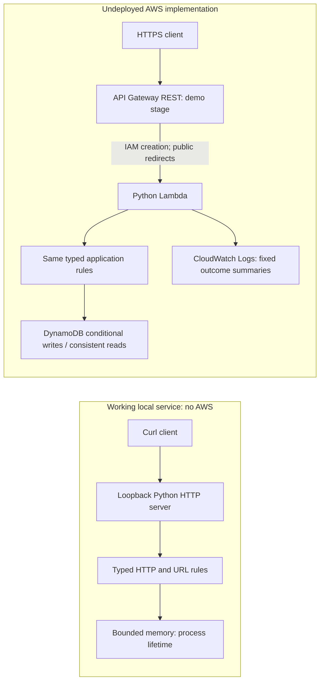

# Serverless URL shortener

[](https://github.com/notfrostedwow/serverless-url-shortener/actions/workflows/checks.yml)

Python 3.11+ · CI on Python 3.11 and 3.12 · [MIT license](LICENSE)

A working Python HTTP service that creates random short links and redirects them
until expiry. It runs without AWS and includes a real DynamoDB adapter and an
**undeployed** SAM template for API Gateway, Lambda, DynamoDB and CloudWatch Logs.
Local requests exercise the same application rules used by the Lambda adapter.
The examples are synthetic. No hosted endpoint or live AWS integration is claimed.

[Run it](#run-locally) · [HTTP contract](#contract) · [Architecture](#architecture) · [Security](SECURITY.md)

## Run locally

Python 3.11+ is required. From this repository in PowerShell:

```powershell
python -m venv .venv
.venv/Scripts/python -m pip install -e .
.venv/Scripts/url-shortener --port 8000
```

Keep that process running. It binds only to `127.0.0.1`, has **no authentication**,
and retains at most 1,000 links **only until the process stops**. Expired records
still occupy capacity; restart to clear them. This is a sequential development
HTTP server with a three-second connection timeout. Never expose or tunnel it.
The local path uses only the standard library, without SDK imports or credentials.

In a second PowerShell terminal:

```powershell
$payload = '{"url":"https://example.com/docs?ref=demo","ttl_seconds":60}'
$created = $payload | curl.exe --noproxy "*" --max-time 3 -sS http://127.0.0.1:8000/links -H "Content-Type: application/json" --data-binary "@-" | ConvertFrom-Json
$created
curl.exe --noproxy "*" --max-time 3 -i "http://127.0.0.1:8000$($created.short_path)"
```

POST returns 201 with `code`, `short_path` and integer UTC `expires_at`. GET returns
302 with the target in `Location` and `Cache-Control: no-store`; after 60 seconds
it returns 404. Curl does **not** use `--location`, so it never visits the target.
Codes/timestamps vary because the live local process uses its real clock and
cryptographic randomness. Stop it with Ctrl+C.

This one-command demo starts the **installed CLI**, executes actual curl requests,
checks 201/302/404/405/400 and stops its child server:

```powershell
.venv/Scripts/python tools/demo.py
```

Read the [actual HTTP session](docs/validation/local-demo.txt) for request and
response headers. On Linux/macOS use `.venv/bin/` instead of `.venv/Scripts/`,
and `curl` instead of `curl.exe`.

## Contract

| Request | Success | Other application responses |
| --- | --- | --- |
| `POST /links` | 201 JSON; relative `Location: r/<code>` | 400 invalid input, 413 body size, 415 media type, 503 storage/collision exhaustion |
| `GET /r/<code>` | 302, ASCII Location, empty body | 404 missing/expired/invalid code, 503 store failure |
| Other standard method on a recognized route | 405 with `Allow` | AWS creation is gated by IAM first |
| Unknown application path | 404 JSON | API Gateway can reject before Lambda |

JSON accepts exactly `url` plus optional integer `ttl_seconds` (default 86,400;
range 1–604,800). Boolean TTLs, duplicate/extra keys and malformed UTF-8/JSON fail.
Decoded bodies are capped at 4,096 bytes; Lambda's raw body cap is 8,192 bytes.
Codes are twelve characters matching `[A-Za-z0-9_-]{12}`. Append `short_path` to
your known API base, including `/demo` in AWS. The relative creation Location
preserves that stage prefix and never trusts the Host header to build a URL.

Targets must be HTTP(S), at most 2,048 original UTF-8 and resulting ASCII bytes.
Controls (also percent-escaped CR/LF), credentials, raw whitespace, backslashes,
bad escapes and malformed hosts fail. Unicode hosts must already use valid ASCII
IDNA A-labels. Unicode path/query/fragment text becomes UTF-8 escapes. Existing
query escapes, `+`, parameter order and empty `?`/`#` delimiters are preserved.
No DNS lookup or target fetching occurs. The exact policy and transport differences
are in [docs/api.md](docs/api.md).

## Architecture



Nine random bytes produce a 72-bit code. Creation attempts at most five atomic
inserts and cannot overwrite a collision. Reads check `now >= expires_at`, even
while DynamoDB TTL deletion is pending. Storage, clock and code generation are
injected for deterministic tests. The SDK has bounded attempts/timeouts.

A shortener is inherently an **open-redirect service**: valid destinations can
still be harmful. Codes are not authorization. The SAM template explicitly
requires IAM for creation; redirects remain public. Offline translation checks
that configuration, not AWS enforcement. Public deployment still needs reviewed
writer policies, quotas, moderation/takedown, abuse monitoring, budgets and
operational ownership. Throttles are best effort, not spending caps. Read
[SECURITY.md](SECURITY.md) and [docs/cloud.md](docs/cloud.md).

## Checks and review

```powershell
.venv/Scripts/python -m pip install -e . -r requirements-dev.txt
.venv/Scripts/python tools/verify.py
```

The verifier runs pytest, real loopback HTTP, SDK Stubber tests, Ruff lint/format,
strict mypy, `pip check`, source SAM cfn-lint, offline SAM translation/security
checks and cfn-lint on generated CloudFormation. Socket/DNS guards prohibit cloud
networking. Temp parents are created explicitly in fresh checkouts.

[docs/verification.md](docs/verification.md) records actual results and limitations.
Python 3.11/3.12 CI has only `contents: read`, pinned actions and no deployment or
credential steps. The badge links to live CI results. These checks do not prove
AWS integration or production readiness.

## Find your way around

```text
src/shortener/
  domain.py           URL validation, random codes, expiry and storage interface
  http.py             Shared request/response contract
  local.py            Loopback-only HTTP server with bounded memory storage
  dynamodb.py         Conditional writes and consistent reads
  aws.py              Lazy-initialized Lambda REST proxy v1 adapter
tests/                Domain, HTTP, SDK Stubber and infrastructure tests
infra/template.yaml   Undeployed API Gateway, Lambda and DynamoDB design
tools/demo.py         Real local HTTP demonstration and cleanup
docs/                 API policy, cloud design and validation records
```

## Possible next steps

An expiry cleanup policy for the local store and idempotent creation requests
would address two current limits. Neither is implemented. Any public deployment
would need abuse handling and real AWS integration tests before use. There is
no administration UI, custom alias feature or analytics dashboard.

[ZAHEER-GUIDE.md](ZAHEER-GUIDE.md) explains the code and interview tradeoffs;
[CONTRIBUTING.md](CONTRIBUTING.md) covers local checks. Original code is
[MIT licensed](LICENSE), Copyright (c) 2026 Zaheer Miah.
Dependencies retain [their own licenses/notices](docs/dependencies.md).
